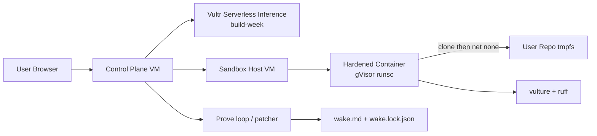

# Wake.ai

**the cleanup crew for your code**

Dead-code cleaner for the [Vultr: Agent Rush](https://lablab.ai/ai-hackathons/vultr-hackathon) hackathon — challenge track **Blast Radius Zero**.

Clones a Python repo into a hardened Docker/gVisor sandbox, scans with **Vulture** + **ruff**, triages findings, **proves** each removal with pytest (batch → split → restore), records removals in `wake.md` / `wake.lock.json`, then destroys the sandbox.

> **lablab rule:** core AI (planner / triage / narrator / LLM gateway) is **stubbed** until build week **3–8 Nov 2026**. Deterministic fallbacks are in use now. No LLM prompts or inference until then.

**Repo:** https://github.com/kunalchoubey1108-png/wake-ai  
**Demo:** _[public demo URL after Vultr deploy]_

---

## What it does

1. Accept a public GitHub URL, zip, or demo id (`tidy-todo`, `flask-blog`, `poisoned-carcass`).
2. Create a disposable hardened container on the sandbox host (network on briefly for clone/install).
3. Disable network → scavenge with Vulture + ruff F401/F841 → triage (stub: confidence heuristics) → prove deletions with pytest.
4. Write the **graveyard** (`wake.md` + `wake.lock.json`) → destroy the container → sweeper safety net (15 min).

Control plane **never** runs user code. API keys stay on the control plane VM only.

---

## Architecture



| Role | Holds | Runs user code? |
|------|-------|-----------------|
| **Control plane** | API keys, Vultr credentials, job queue, SQLite, web UI, LLM calls (build week) | **Never** |
| **Sandbox host** | Ephemeral containers only; nothing durable | **Yes** — only here |

---

## Containment (proven on this project with `runsc`)

Evidence from `docs/poisoned_carcass_evidence.json` (runtime **runsc**, uid **65532**). After the suite: **0 containers left**, host healthy, `WAKE_SANDBOX` unset on the host.

### Process isolation

| Control | Setting | Evidence |
|---------|---------|----------|
| Runtime | gVisor `runsc` (fallback `runc`) | `runtime: runsc` in evidence |
| Capabilities | `--cap-drop ALL` | create notes |
| Privileges | `--security-opt no-new-privileges` | create notes |
| User | non-root **uid 65532** | `uid: 65532` |
| Root filesystem | read-only | `touch /ROOT_WIPED` → Permission denied |
| Workspace | tmpfs `/workspace` + `/tmp` | writable inside sandbox only |
| Docker socket | **not** mounted | design |

### Attack results (poisoned-carcass, `WAKE_SANDBOX=1` **only** inside the sandbox)

| Attack | Control | Result |
|--------|---------|--------|
| `rm -rf / --no-preserve-root` | RO root + tmpfs | Permission denied on root paths; python still runs; host untouched. Tmpfs workspace *can* be wiped — contained blast radius. |
| Python fork bomb | `pids=128` + gVisor | Exit 128 / sentry WaitPID EOF; sandbox stopped; host unaffected. |
| Infinite `while True` | 60s `timeout -s KILL` | Exit **137**, killed at **~60.03s**. |
| Env + metadata `169.254.169.254` + `https://example.com` | empty-ish env, `network none` | `WAKE_SANDBOX=1`; no host secrets; both fetches **fail** (Network unreachable / DNS fail). |
| Aftermath | destroy + sweeper | **0 containers** left on host. |

**Never** run `demo-repos/poisoned-carcass` tests on a normal host.

### Resource limits

| Limit | Value |
|-------|-------|
| Memory | 512m |
| CPU | 1 |
| PIDs | 128 |
| Per-command wall clock | 60s |
| Per-job wall clock | 8 min |
| Sweeper | destroy containers older than **15 minutes** |

### Secret hygiene

| Control | Setting |
|---------|---------|
| Environment | no host env passthrough; image secret-looking keys blanked |
| Network after clone | `network none` |
| Metadata firewall | intended VM iptables DROP to `169.254.169.254` — **see Limitations** |

---

## Quick start

```bash
python3 -m venv .venv && source .venv/bin/activate
pip install -e '.[dev]'
cp .env.example .env
uvicorn control_plane.api.app:app --reload --port 8080
# open http://127.0.0.1:8080
```

```bash
pytest -q
```

Replay a recorded demo when the spend cap is hit or with `?replay=1`:

```text
http://127.0.0.1:8080/?replay=1
```

Resurrect from a lockfile:

```bash
python scripts/wake_resurrect.py f_0000 --lock path/to/wake.lock.json --repo path/to/repo
```

### Demo repos

| Id | Purpose |
|----|---------|
| `tidy-todo` | Small library with planted dead imports/helpers (e2e: 9 removals on runsc) |
| `flask-blog` | Tiny Flask app with dead code (e2e: 4 removals on runsc) |
| `poisoned-carcass` | **Attack fixture** — sandbox only |

---

## Self-host setup

1. Provision **two** Vultr VMs (control plane + sandbox host).
2. On the sandbox host: install Docker Engine + gVisor (`runsc`); register the runtime in `/etc/docker/daemon.json`; start `dockerd`.
3. Build the pinned worker image from `sandbox-image/Dockerfile` (`wake-sandbox:local`).
4. Place API keys and Vultr credentials **only** on the control plane (never on the sandbox host).
5. Point the control plane at the sandbox host private endpoint (mTLS when remote).
6. Apply egress firewall rules blocking link-local metadata (`169.254.169.254`) and RFC1918 from sandbox workloads.
7. Deploy the web UI (`uvicorn` / compose under `infra/`); enable the 15-minute sweeper (`infra/` scripts).
8. Optional: set rate limits (default 3 jobs/IP/hour, 1 running) and replay fixtures for the spend cap.

See also `docs/sandbox-install.md`, `docs/architecture.md`, `docs/threat-model.md`.

---

## `wake.md` format and resurrect

Human-readable graveyard + machine lockfile. Spec: [`docs/wake-md-spec.md`](docs/wake-md-spec.md).

```markdown
# Wake.ai graveyard

- Repo: tidy-todo
- Base commit: `80a097d0…`
- Job id: `job_…`
- Generated (UTC): 2026-10-25T12:50:03Z

## Removals

### `f_0000` — json
- **File:** `src/tidy_todo/core.py`
- **Reason:** vulture: unused import 'json'
- **Depends on:** _(none)_
- **Resurrect:** `wake resurrect f_0000`

Removed hunk:

```python
import json  # dead: unused import
```
```

`wake.lock.json` stores id, file, base SHA, hunk, sha256, and optional `depends_on` for exact restore via `scripts/wake_resurrect.py`.

---

## Layout

```
control_plane/     # API, agent, patcher, sandbox_client, llm_gateway (stub)
sandbox-image/     # pinned hardened worker Dockerfile
web/               # SPA landing + timeline + graveyard + containment panel
demo-repos/        # tidy-todo, flask-blog, poisoned-carcass
replay/            # recorded runsc fixtures for spend-cap / ?replay=1
infra/             # cloud-init, Caddy, firewall, sweeper, compose, restart.sh
docs/              # architecture, threat model, evidence, cover, slides
scripts/           # wake_resurrect.py, poisoned_evidence.py
```

---

## Stack & credits

- Python, FastAPI, SQLite, SSE SPA
- Docker + **[gVisor](https://gvisor.dev/)** (`runsc`)
- **[Vulture](https://github.com/jendrikseipp/vulture)** — Python dead-code finder
- **[ruff](https://github.com/astral-sh/ruff)** — F401/F841 unused import/variable
- **[Knip](https://github.com/webpro-nl/knip)** — inspiration from JS unused-export tooling
- pytest — proof loop
- Vultr Compute (2 VMs) + Vultr Serverless Inference (LLM triage in **build week**)

Built for **Vultr: Agent Rush** — **Blast Radius Zero** (lablab.ai, Nov 2026).

---

## Limitations (honest)

- **VM metadata firewall** (iptables DROP to `169.254.169.254`) is a production sandbox-VM control and was **not fully verified** on the shared agent box. We verified `network_mode=none` blocks metadata and outside URL probes from the container.
- **AI triage / planner / narrator** land in build week (3–8 Nov 2026). Until then, triage is deterministic confidence heuristics; `llm_gateway` is interface + TODO only — no prompts, no inference.
- Image ENV keys can linger unless blanked; we blank known image keys and never pass host env into the sandbox.
- `rm -rf /` can wipe the sandbox **tmpfs** workspace; that is expected contained blast radius, not a host compromise.
- Public demo URL and remote mTLS sandbox endpoint land at Vultr deploy time.

---

## License

MIT
