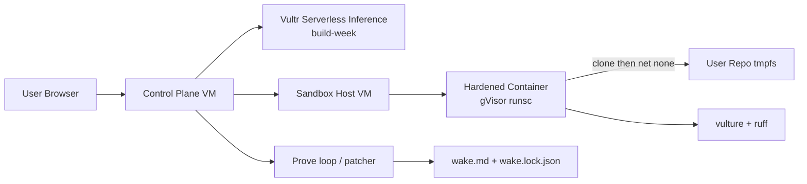

# Architecture

## Split of trust

| VM | Holds | Runs user code |
|----|-------|----------------|
| Control plane | API keys, SQLite jobs, web UI | **Never** |
| Sandbox host | Docker/gVisor only | **Yes** |

## Job lifecycle
1. Accept GitHub URL / zip / demo id  
2. Create sandbox (network on) → clone/install  
3. Disable network  
4. Scavenge → triage (stub: confidence) → prove  
5. Write graveyard → destroy container → sweeper safety net  
